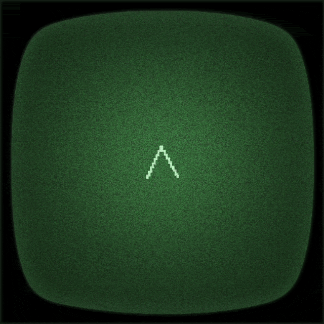
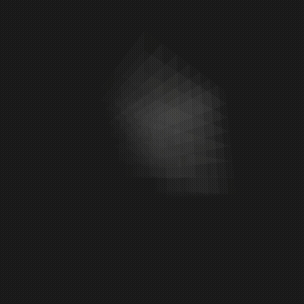

# North Engine

A small experimental game engine written in Java on top of LWJGL 3 (OpenGL 3.2) and an
Entity-Component-System architecture. It is a learning project: the API is unstable and
features are added incrementally.

> Status: work in progress. See [TODO.md](TODO.md) for the current focus and the list of
> implemented / planned features.
---

**Spaceship demo**  


**Cube grid demo scene**  


---

## Features

- Flat ECS: `Entity`, `EntityManager`, `ComponentManager` with deferred component changes.
- OpenGL renderer: shaders, materials, textures, built-in meshes, OBJ loading,
  screen-space (UI) layer and explicit render order.
- Asset service with loaders for shaders, textures, OBJ meshes and WAV audio.
- Spatial index (octree) and `MeshCollider` for picking and collision detection.
- Audio through OpenAL; falls back to a silent no-op backend when no device is available.
- Keyboard/mouse input plus a web gamepad controlled from a phone over the local network.
- Logging through SLF4J + Logback.

## Requirements

- JDK 11 or newer
- A GPU/driver with OpenGL 3.2 support
- Maven 3.8+

## Build and run

Maven is the build tool:

```bash
mvn -pl north-app-desktop -am package
java -jar north-app-desktop/target/north-app-desktop-0.0.1.jar
```

Use a different configuration file with `--config`, `-Dnorth.config`, or `NORTH_CONFIG`:

```bash
java -Dnorth.config=./north-dev.properties -jar north-app-desktop/target/north-app-desktop-0.0.1.jar
```

Build every module:

```bash
mvn package
```

Run the tests:

```bash
mvn test
```

The scene that starts is selected by `application.scene` in `north.properties`.

## Project layout

```
north-common/src/main/java/io/github/cucumberbatch/north/
├── architecture/   DI container (ApplicationContext, Initializer, Inject), FrameSync
├── config/         ApplicationProperties
├── io/             classpath resource loading
├── memory/         pooling and buffer helpers
└── utils/          small helpers (timing)

north-core/src/main/java/io/github/cucumberbatch/north/
├── architecture/   Engine, Pipeline (main loop), component-handler scanning
├── scene/          Entity, EntityManager, components, scene composers, deferred commands
├── system/         systems and process interfaces
├── graphics/       window, shaders, meshes, materials, textures, predefined meshes
├── asset/          AssetService and asset loaders
├── audio/          OpenAL wrapper: Audio, AudioClip, AudioSource
├── physics/        collisions, shapes, octree spatial index
└── io/             Input and the remote web-gamepad server

north-app-desktop/src/main/java/io/github/cucumberbatch/north/architecture/
└── Application.java   desktop launcher and config selection
```

Default configuration lives at `north-common/src/main/resources/north.properties`.
The desktop main class is `io.github.cucumberbatch.north.architecture.Application`.

Assets live in `north-core/src/main/resources/assets/` and are loaded by classpath path.

## How a frame works

`Engine` creates the window, graphics, audio, input, the component/system managers and the
remote input server, then starts `Pipeline`. Every frame runs the stages in this order:

1. `init` newly added components,
2. `handleInput` / `updateInput`,
3. `update(deltaTime)`,
4. collision registration and handling,
5. deferred commands are applied,
6. `render`.

Component add/remove is deferred: `componentManager.add(...)` returns the component
immediately, but it becomes visible to systems at the end of the frame.

## API

### Entities and components

```java
EntityManager entities = ...; // provided by the engine
ComponentManager cm = ...;

Entity player = entities.create("player");

Transform transform = cm.add(player, Transform.class);
transform.moveTo(0f, 1f, 0f);
transform.rescaleTo(1f, 1f, 1f);

MeshRenderer renderer = cm.add(player, MeshRenderer.class);
renderer.mesh = PredefinedMeshes.CUBE;
renderer.material = new Material(shader)
        .setVector("u_color", new Vector4f(1f, 0.5f, 0.2f, 1f));

// lookup
Transform same = player.getComponent(Transform.class);
boolean hasCamera = player.hasComponent(Camera.class);

// removal is deferred as well
player.removeComponent(MeshRenderer.class);
```

`Transform` hierarchy is expressed through `Transform.parentTransform`, not through an entity
tree. `EntityManager` keeps a flat list and supports `create`, `add`, `remove`, `find(name)`,
`findFirst(predicate)`, `getAll` and `size`.

### Custom components and systems

A component extends `AbstractComponent`. A system handles exactly one component type, is
annotated with `@ComponentHandler`, and must live in the scanned package
(`system.package`, default `io/github/cucumberbatch/north/system`).

```java
public class Spinner extends AbstractComponent {
    public float speed = 1f;
}

@ComponentHandler(Spinner.class)
public class SpinnerSystem extends AbstractSystem<Spinner>
        implements InitProcess<Spinner>, UpdateProcess<Spinner> {

    @Inject
    public SpinnerSystem(ApplicationContext context) {
        super(Spinner.class, context);
    }

    @Override
    public void init(Spinner spinner) {
    }

    @Override
    public void update(Spinner spinner, float deltaTime) {
        Transform transform = cm.get(spinner.getEntity(), Transform.class);
        transform.moveRel(0f, spinner.speed * deltaTime, 0f);
    }
}
```

Available process interfaces:

| Interface | Method |
| --- | --- |
| `InitProcess<C>` | `init(C component)` |
| `UpdateProcess<C>` | `update(C component, float deltaTime)` |
| `RenderProcess<C>` | `render(C component, Graphics graphics)` |
| `InputHandlerProcess<C>` | `handleInput(C component, Input input)` |
| `CollisionHandlerProcess<C>` | `onCollisionStarted/Continued/Ended(C, Collision)` |

A system is instantiated lazily the first time a matching component is added to an entity.
`AbstractSystem` gives subclasses `cm`, `entityManager`, `assetService` and `sceneRoot`.

### Rendering

```java
Shader shader = assets.get(Shader.class, "assets/shaders/texture_shader"); // loads .vert + .frag
Texture texture = assets.get(Texture.class, "assets/textures/box.png");

Material material = new Material(shader)
        .setTexture("u_texture", texture)
        .setVector("u_color", new Vector4f(1f, 1f, 1f, 1f))
        .setFloat("u_alpha", 1f);
```

`Material` binds `u_projection`, `u_view` and `u_model` automatically; other uniforms are set
with `setInt`, `setFloat`, `setVector`, `setMatrix` and `setTexture`.

`MeshRenderer` draws the mesh using the entity `Transform`. Set `screenSpace = true` to
interpret the transform in window pixels (drawn on top of the world) and use `renderOrder`
to order overlapping elements. `MeshCollider` with `space = Space.WORLD` is used for scene
picking, `Space.SCREEN` for UI hit-testing; leave `localBounds` empty to derive it from the
renderer mesh.

### Assets

`AssetService.get(Class<T>, path)` loads from the runtime classpath and caches by path:

| Type | Path | Notes |
| --- | --- | --- |
| `Shader` | `assets/shaders/<name>` | loads `<name>.vert` + `<name>.frag`; `.vert`/`.frag` also accepted |
| `Texture` | `assets/textures/*.png` | loaded through `ImageIO` |
| `Mesh` | `assets/meshes/*.obj` | triangles, polygons, negative indices, UVs; normals and MTL are ignored |
| `AudioClip` | `assets/audio/*.wav` | converted to 16-bit PCM and uploaded to OpenAL |

Custom loaders extend `AssetLoader<T>` and are registered with
`assetService.registerAssetLoader(Type.class, loader)`.

Built-in meshes (`PredefinedMeshes.CUBE`, `QUAD`, ...) need no loading and can be assigned to
`MeshRenderer.mesh` directly.

### Audio

```java
AudioClip clip = assets.get(AudioClip.class, "assets/audio/footstep.wav");

AudioSource source = audio.createSource();
source.setClip(clip);
source.setGain(0.8f);
source.setPosition(new Vector3f(0f, 0f, 0f));
source.play();
// ...
source.close();
```

If no OpenAL device can be opened, `audio.isAvailable()` is `false` and all calls become
no-ops, so the game keeps running without sound.

### Input

Systems receive input through `InputHandlerProcess`:

```java
@Override
public void handleInput(Spinner spinner, Input input) {
    if (input.isPressed(GLFW.GLFW_KEY_SPACE)) { }   // this frame only
    if (input.isHeld(GLFW.GLFW_KEY_W)) { }          // while held
    if (input.isReleased(GLFW.GLFW_KEY_ESCAPE)) { } // this frame only

    Vector2f cursor = input.getCursorPosition();
    float axis = input.getAxis("move-x");           // analog axes (remote gamepad)
}
```

`Input` also exposes `setAxis`, `injectKeyPress` / `injectKeyRelease` and `clearKeyHold` for
alternative input sources. This is how the remote gamepad feeds the same input state as a
physical keyboard.

### Scenes

A scene is a `SceneComposer` that fills an empty entity manager:

```java
public void compose(EntityManager entities, ComponentManager cm) {
    Entity camera = entities.create("camera");
    cm.add(camera, Transform.class, Camera.class);
    // ...
}
```

Built-in scenes are registered in `DefaultSceneComposer.initScenesMappings()`. Add new ones
there and select them with `application.scene`.

## Configuration

All engine settings are read from
[`north-common/src/main/resources/north.properties`](north-common/src/main/resources/north.properties).
Change a value and rebuild the project. The desktop launcher can also load a different
configuration file with `--config`, `-Dnorth.config`, or `NORTH_CONFIG`. When launching the
engine JVM directly, remote-input properties can additionally be overridden with a
`-Dnorth.<property>=value` system property, for example:

```bash
java -Dnorth.application.remote-input.port=9090 -jar north-app-desktop/target/north-app-desktop-0.0.1.jar
```

| Property | Default | Description |
| --- | --- | --- |
| `application.window.title` | `test_view` | Window title |
| `application.window.width` | `512` | Window width in pixels |
| `application.window.height` | `512` | Window height in pixels |
| `application.window.vsync` | `false` | Enable vertical sync |
| `application.scene` | `footsteps` | Scene to load at startup |
| `application.editor.enabled` | `false` | Editor mode |
| `application.editor.camera.intermediate-state-on-focus-loss` | `true` | Animate the camera projection when the window loses focus |
| `application.editor.process.update.smooth-stop-and-start` | `true` | Smoothly stop/start the update process |
| `application.remote-input.enabled` | `true` | Start the web gamepad server |
| `application.remote-input.port` | `8080` | HTTP/WebSocket port |
| `application.remote-input.bind` | `0.0.0.0` | Bind address of the server |
| `application.remote-input.auto-open-browser` | `false` | Open the gamepad URL in the default browser on start |
| `application.remote-input.cursor-speed` | `1.0` | Cursor speed multiplier for the gamepad |
| `system.package` | `io/github/cucumberbatch/north/system` | Package scanned for `@ComponentHandler` systems |
| `process.package` | `io/github/cucumberbatch/north/system/process` | Package scanned for process interfaces |

`project.*`, `scene.storage.*` and `logger.severity` are reserved for future use.

## Remote gamepad

On start the engine serves a touch-friendly gamepad over the local network. Open the printed
URL on a phone connected to the same network:

```
http://<local-network-address>:8080/
```

Every button and stick is delivered into the engine `Input`, so the game reacts to the phone
exactly like it reacts to a physical keyboard (the footsteps scene is a good demo).

Bindings live in `north-core/src/main/resources/remote/gamepad.properties`. To change them without
rebuilding, put a `remote-gamepad.properties` file into the working directory or point the
`north.remote.gamepad.bindings` system property to a custom file. Key names are GLFW names
(`SPACE`, `ESCAPE`, `W`, `LEFT_SHIFT`, `UP`, ...).

## Built-in scenes and controls

| Scene | Description |
| --- | --- |
| `footsteps` (default) | Third-person test scene: player, floor, markers and one-shot footsteps. Move with W/A/S/D or the arrow keys. |
| `cube-and-camera` | Camera controls and a cube. |
| `cursor-demo` | Screen-space cursor overlay with labels and object selection. |
| `spaceship` | Screen-space sprite demo. |
| `cube-grid` | Grid of transparent cubes for render-order testing. |

Camera controls (`cube-and-camera`, `cube-grid`): click the left mouse button to capture the
cursor, W/A/S/D to move, Q/E to move down/up, hold Left Shift to speed up, `1` to toggle
perspective/orthographic projection, Esc to release the cursor.

## Limitations

- The API is not stable; packages and class names still change.
- OBJ import ignores normals and MTL materials; only position and UV are used.
- Audio supports WAV only.
- Configuration file changes require a rebuild, except for the remote-input properties.
- The entity tree class is legacy and is being redesigned; entity hierarchy is component-based.

See [TODO.md](TODO.md) for the roadmap.
